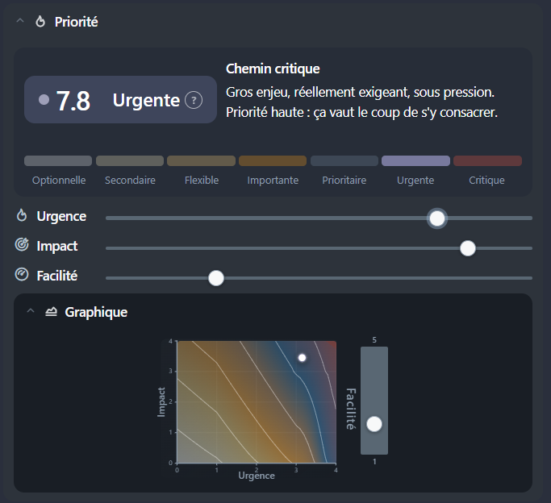
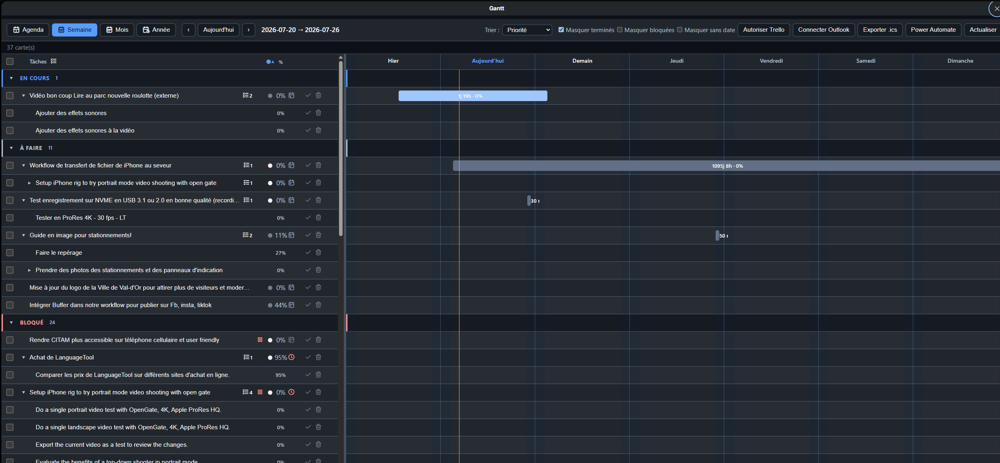
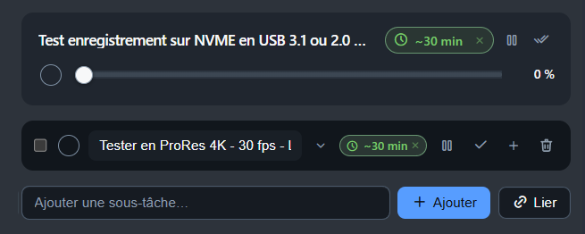

<!-- lang -->[Français](README.md) | **English**

# Trello Cerveau

A Trello Power-Up to decide what to do first: urgency / impact / ease priority, subtasks, Gantt, Kanban, Documents and an AI assistant, right inside your boards.

> Tu as toujours plein de grandes choses à faire, mais si peu de temps? Avec un système qui fonctionne, tu passes moins de temps à faire des listes et plus de temps à profiter de la vie.
>
> *You always have so much to do and so little time? A system that works means less list-making, more living.*



## Features

- **Three-axis priority**: urgency (0–4), impact (0–4), ease (1–5). A score from 0 to 10 and a tier (Critical, Urgent…) are shown as a badge on the card.
- **Sort by priority** for a list, or automatically on every change.
- **Subtasks and progress**, precise due dates, history with undo.
- **Full-screen views**: Table, Gantt, Kanban, Mindmap, Documents, Dashboard.
- **Documents**: editor with `@` person, `@@` task, `@@@` document mentions, saved in Trello ([docs/documents.md](docs/documents.md)).
- **AI assistant** (ChatGPT or OpenRouter) that knows your cards.
- **Optional syncs**: Outlook ([docs/outlook-entra-setup.md](docs/outlook-entra-setup.md)) and Google Sheets ([docs/sheet-sync.md](docs/sheet-sync.md)).

| Gantt | Subtasks |
|---|---|
|  |  |

## Quick start

The Power-Up is a static site (HTML/JS/CSS, no build step) hosted on GitHub Pages.

1. **Fork** this repository, then in *Settings → Pages* choose **Source: GitHub Actions**. Every push to `main` deploys the site.
2. At [trello.com/power-ups/admin](https://trello.com/power-ups/admin), create a Power-Up with the connector URL `https://VOTRE-UTILISATEUR.github.io/trello-priority-powerup/index.html`.
3. Enable the capabilities `card-badges`, `card-detail-badges`, `card-back-section`, `board-buttons`, `list-sorters` and `on-enable`.
4. Add the Power-Up to a board.

The details (API key, automatic sorting, capabilities, troubleshooting) are in [docs/trello-setup.md](docs/trello-setup.md). To automate steps 1 and 2, see `scripts/setup.ps1` (Windows) or `scripts/setup.sh`.

## Development

Prerequisites: Node.js 18 or later.

```bash
npm run dev           # serveur local
npm run test:unit     # tests unitaires
npm test              # tests unitaires + vérifications sandbox
npm run test:coverage # avec couverture
```

The `npm test` and `npm run verify` suites include `verify:presets`, which requires Windows (`cscript`).

## Structure

| Path | Role |
|---|---|
| `index.html` | Power-Up connector |
| `popup.html`, `settings.html`, `profile.html`, `card-open.html` | Card and board modals |
| `table.html`, `gantt.html`, `kanban.html`, `mindmap.html`, `docs.html`, `dashboard.html`, `entities.html` | Full-screen views |
| `components/` | Code by domain (JS + CSS side by side); `shared/` for common code |
| `workers/trello-sheet-sync/` | Cloudflare Worker for Google Sheets sync |
| `docs/` | Setup guides and design notes |
| `scripts/` | Dev server, test runners, setup scripts, build timestamping |
| `sandbox/` | Prototypes and verification scripts, not deployed |
| `test/` | Unit tests |

## Contributing

1. Open an issue to discuss the change.
2. Get `npm test` passing (or at least `npm run test:unit`) and add a test for any logic you change.
3. Add a line in French to [CHANGELOG.md](CHANGELOG.md) for any user-visible change.
4. Open a pull request.

The interface is in French (Québec).

## License

[MIT](LICENSE)
